<p align="center">
  <picture>
    <source media="(prefers-color-scheme: dark)" srcset="docs/images/hero-dark.png">
    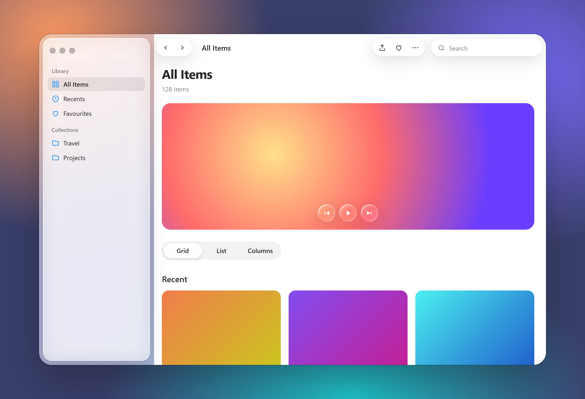
  </picture>
</p>

<h1 align="center">UI Themes</h1>

<p align="center">
  <b>Drop-in UI themes for web apps, packaged as a Claude Code plugin.</b><br>
  Starts with macOS 26 Liquid Glass: real refraction, light that follows your pointer,<br>
  and glass that stretches, melts and splits like liquid.
</p>

<p align="center">
  <a href="https://github.com/dayztoolsforu/ui-themes/releases"></a>
  <a href="LICENSE"></a>
  
  
</p>

```
/plugin marketplace add dayztoolsforu/ui-themes
/plugin install ui-themes@ui-themes
```

Then ask Claude: **"apply the Liquid Glass theme to this project"**.

---

## One sentence, whole app

Claude installs the theme, wires it into your stack and maps your existing layout onto it. Your features keep working.

| Before | After |
|:---:|:---:|
| 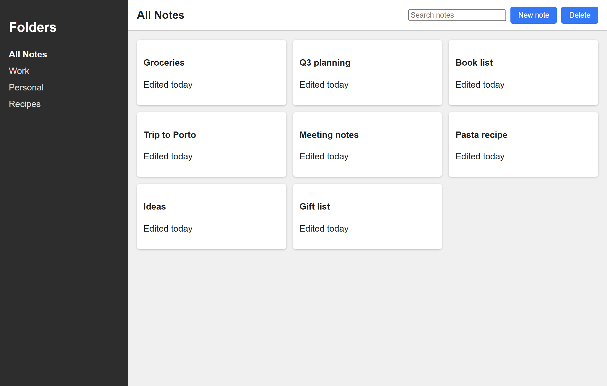 | 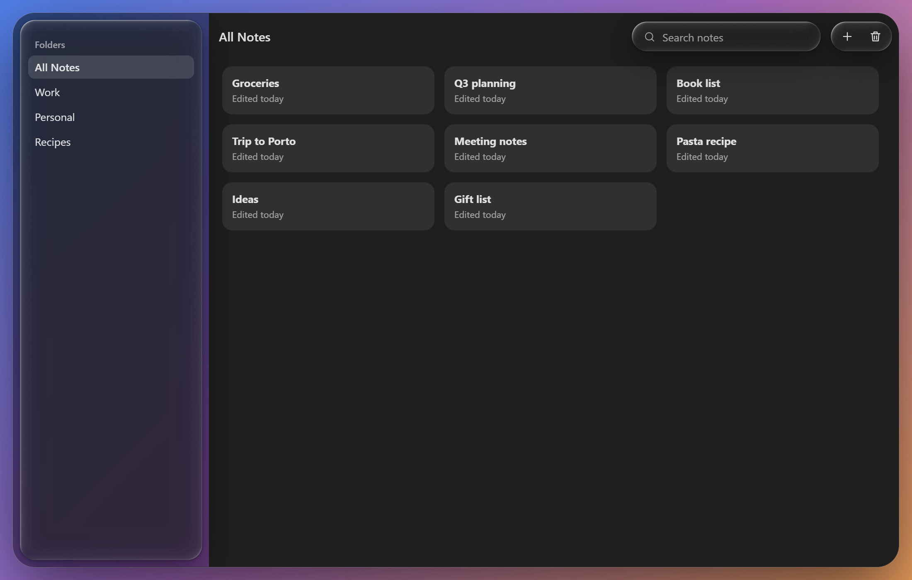 |

## Glass that behaves like liquid

Every edge rides its own spring, so glass stretches as it moves, thins as it grows, overshoots a little and settles. Shapes closer than their container's spacing melt together, and pull apart through a neck that thins and snaps.

| | |
|:---:|:---:|
| 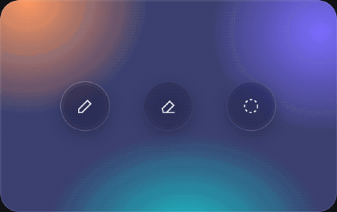<br><sub>Droplets melt into one pill and split</sub> | <br><sub>Pull one out: it stretches and snaps back</sub> |
| 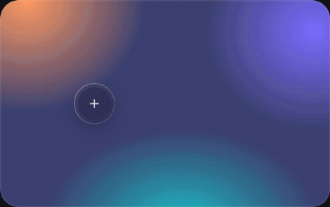<br><sub>A button stretches into a toolbar</sub> | 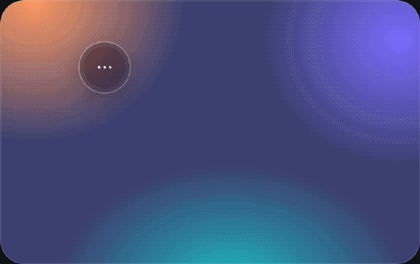<br><sub>Menus pour out of their button</sub> |
| 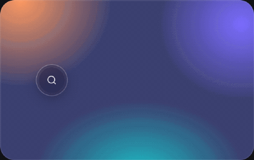<br><sub>Search opens into a field</sub> | 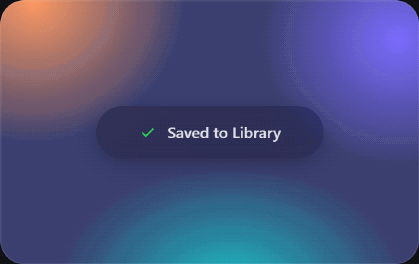<br><sub>Glass materializes instead of fading</sub> |

## Real refraction and light

The rim of every glass element bends what's behind it, like a thick lens, while the middle stays readable. A highlight runs along the edge facing the light, with a fainter reflection on the far side, and the glass lights up under your pointer.

<p align="center">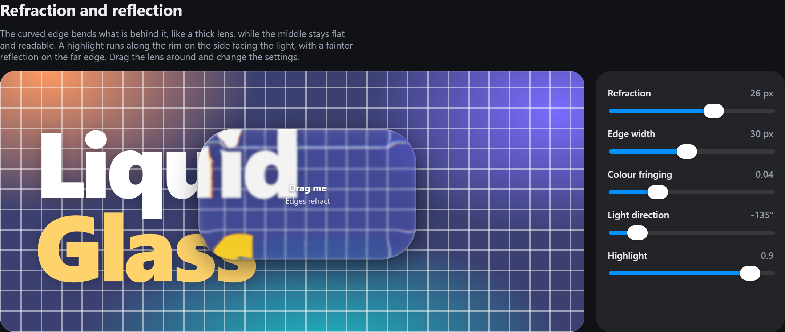</p>

## The whole kit

<p align="center">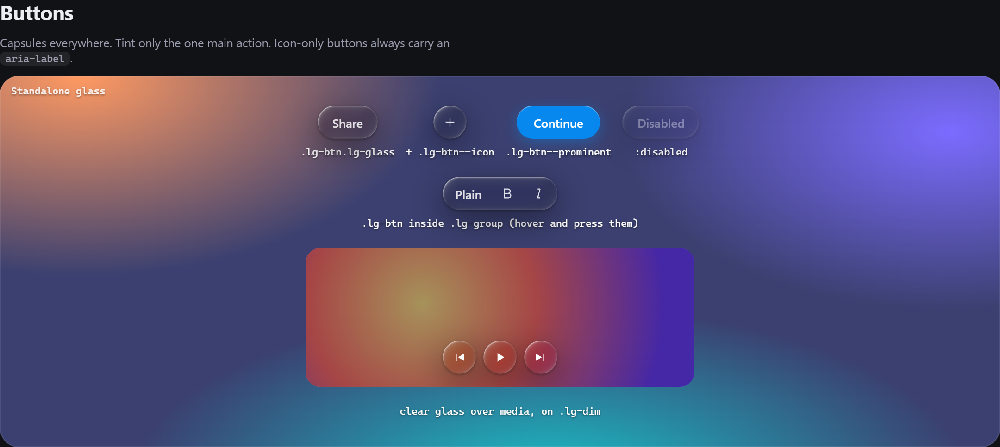</p>
<p align="center">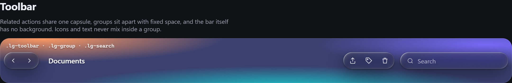</p>
<p align="center">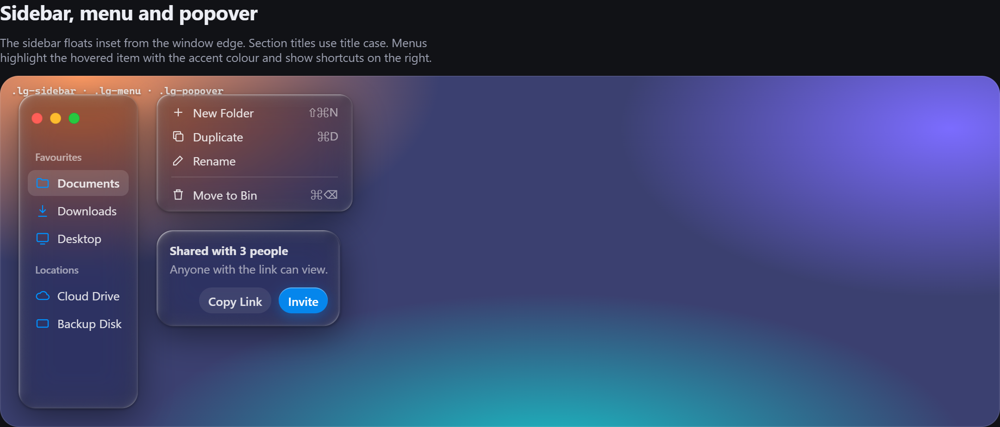</p>
<p align="center">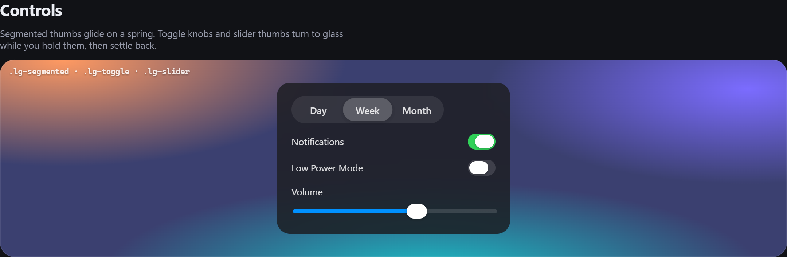</p>

## macOS typography and colour

The eleven macOS text styles with Apple's sizes, line heights and SF Pro tracking, and the system colours for light, dark and increased contrast.

<p align="center">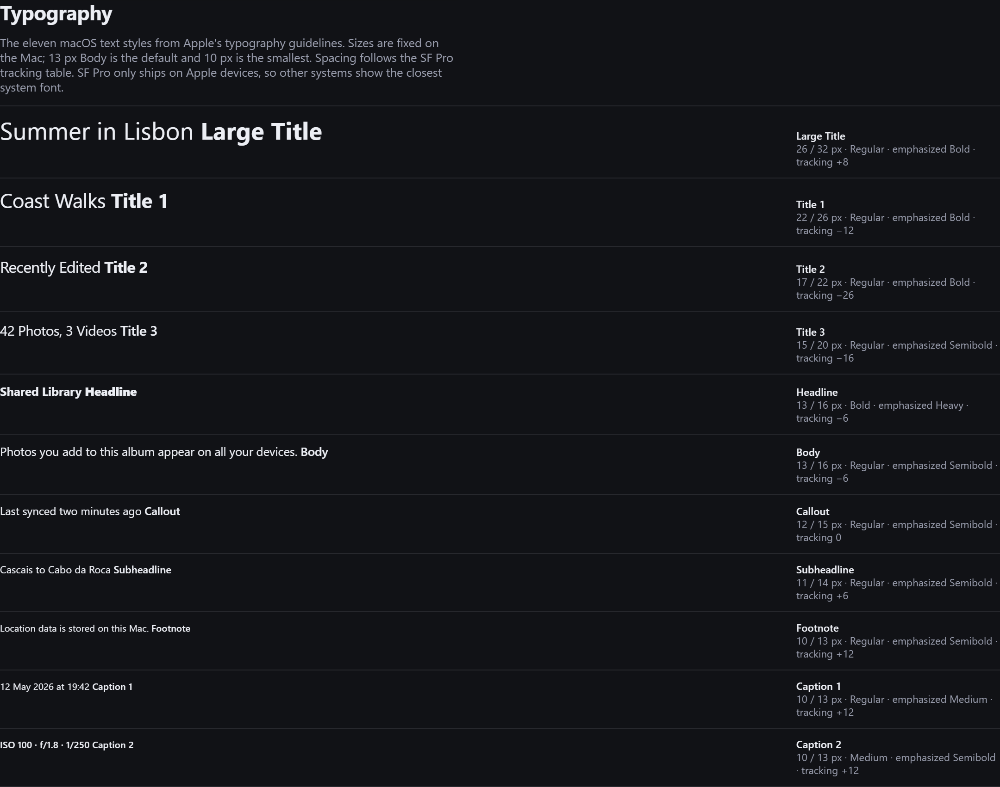</p>

---

## Use

| You say | What happens |
|---|---|
| "Apply the Liquid Glass theme to this project" | Installs the files, wires them in for your stack, maps your shell, toolbars, buttons, menus, text and colours onto the theme, then checks it |
| "Make a macOS-style settings page" | Builds new UI with the theme's components and Apple's rules |
| "Review this UI against Liquid Glass" | Checks layering, glass placement, padding, type and accessibility |
| "Create a Material 3 theme" | Uses `create-ui-theme` to build a new theme in the same structure |

Or by hand:

```
node skills/macos-liquid-glass/scripts/apply-theme.mjs <your-project>
```

It copies `liquid-glass.css` and `liquid-glass.js` and prints the lines to add. Then:

```js
LiquidGlass.init();                                    // refraction, highlights, pointer glow
LiquidGlass.morph(glass, { closed, open, trigger });   // anything that opens
LiquidGlass.liquid(glass, { blobs, spacing });         // shapes that melt and split
LiquidGlass.materialize(glass, true);                  // glass that appears
```

## What's in the box

| | |
|---|---|
| `skills/macos-liquid-glass` | The theme: CSS kit, optics script, live gallery, demo window, installer, framework notes and researched Apple specs (each value marked as stated by Apple or estimated) |
| `skills/create-ui-theme` | A template and guide for building new themes the same way |

## Browser support

The theme works in current Chrome, Edge, Safari and Firefox. Edge refraction uses `backdrop-filter: url()` and renders in Chromium browsers; the others keep the frost, highlights and motion. With the system's reduce-transparency setting on (on Windows, Transparency effects off) the glass turns solid on purpose, and Reduce Motion removes the elastic flex.

## Performance

Glass that warps is redrawn as vector outlines, about 1 ms per frame for three melting shapes. Lens maps are built once when a shape settles, and static glass builds lazily as it comes into view.

## Notes

Styled after Apple's macOS 26 design language. Not affiliated with or endorsed by Apple. Apple, macOS and SF Pro are trademarks of Apple Inc. No Apple fonts, icons or artwork are included: text uses the system font stack and every icon is drawn in code.

## Licence

MIT, see [`LICENSE`](LICENSE).
